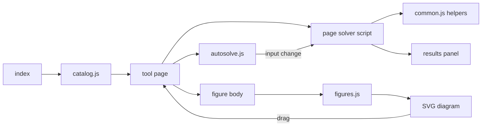

# eng tools

homework calculators for engineering and math

## Summary

A static site of browser calculators I use for engineering and math homework. Each page does one calculation: plug in what you know and it fills in the rest. Everything runs in the browser, nothing is stored or sent anywhere.

## Project structure

- `index.html`: the tool directory, grouped by subject
- `style.css`: the shared dark stylesheet
- `css/calculator.css`: the shared calculator component sheet: figure, inputs, and results
- `js/common.js`: formatting, interpolation, and linear-algebra helpers shared across tools
- `js/figures.js`: the shared figure toolkit that draws the interactive diagrams
- `js/autosolve.js`: the shared live-solving layer that reacts to every input change
- `js/catalog.js` and `js/catalog-view.js`: the tool directory data and index rendering
- `tools/<subject>/`: one page per tool, with its solver in a matching script file

## Architecture



Each tool page is plain HTML that loads a shared calculator layout and its own solver script from a matching `.js` file. The solver reads the form, runs the calculation, and writes the result back into the page. Static hosting, no build step, no backend.

Every page follows the same layout contract: a full-width equation row, then a figure on the left, the input groups in the middle, and a results list on the right. `css/calculator.css` owns that layout, so a page never brings its own panel styling. Inputs start with a working example dataset shown in a dimmed default style, and the values turn normal once they are edited. Units live in the field labels. Blank fields mark quantities the solver determines.

There is no solve button. `js/autosolve.js` listens for every input change, debounces it, and calls the solver that owns that field, so the results and the diagram update as soon as a value settles. While a value is still being typed the previous results stay on screen, and the warning for an impossible value only appears once the input has been left alone for a moment. Clicking into a defaulted field selects the shipped value so typing replaces it.

Every tool page also draws an interactive diagram. The page's own solver produces the numbers; `js/figures.js` renders them as hand-built SVG, and a small per-page figure function chooses the shape of the drawing. Dragging a marked point on a diagram writes the value back into the matching input and re-solves the page, so the diagram and the numbers stay in agreement.

## Testing

Serve the folder and open it:

```
python3 -m http.server 8090
```

Then point a browser at localhost:8090 and try the tools: every calculator was checked against hand-worked homework answers, so plug in a known case and compare the result.

Run the automated checks from the repository root:

```
node tests/verify.js
node tests/catalog_check.js
```

`tests/verify.js` exercises every solver against hand-worked values. `tests/catalog_check.js` checks that the catalogue lists every tool page exactly once.

For the diagrams: open a page that has one and check that it draws on load, that the axes carry sensible units, and that dragging the marked point changes the numbers in the result panel and the input field together. Diagrams are sized for one viewBox, so they scale with the column instead of reflowing.

Check a layout change at a wide window and a phone width. The calculator block has to fit the window without sideways scrolling, and only the text inputs keep an outline.

Check a live-solving change by editing one field on a page with a figure. The results and the marker on the diagram have to agree with the new value, an emptied or impossible field has to keep the last good numbers until the value settles, and the warning has to appear after that.

## Contributing

Branch off main, open a PR, and merge without fast-forward. Keep files small, use snake_case where it applies, and LF line endings only.